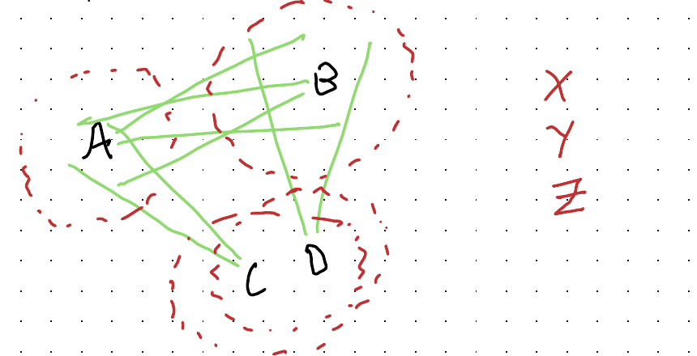

::: {.callout-note}
## About this post: an experiment

This post has been published in two versions at the same time, labelled only **A** and **B**: [Version A](../mmds-a/index.qmd) · [Version B](../mmds-b/index.qmd).

Both versions start from the same handwritten draft by Jon Minton. One is that draft with light proofreading only: typos, grammar slips and hyphenation. The other has been heavily edited by AI. Claude Code (Claude Opus 5.5) acted as the main editor. OpenAI's Codex (gpt-6-astra) then reviewed that edit and suggested rewordings, especially of passages that read as typical of Claude, and Claude Code revised any of those rewordings that read as typical of OpenAI models. Both versions share the same title, figures and section headers. Headers marked † were added by Claude, in both versions.

Which version is which was decided by a coin toss, and the answer is not recorded anywhere in this site's source code. It has been committed in advance as the SHA-256 hash `8fdd2876f883600c12141d05a572ba77e643048c6d1f70f7c8f04738a3cff17c`, so when the answer is revealed, anyone can check that it was not changed after the fact. The hypotheses being tested will be published with the reveal.

Details of how to register which version you prefer will be added here.
:::

The future is here: it's just unequally distributed. Capabilities have never been spread so unevenly, and what holds people back is mindset and institutional barriers, not a lack of resources. My business is trying to address both, but mindset comes first.

## What gets lost †

Over the last year, software development changed. People who had spent years learning to write code stopped writing it - or at least stopped writing it by hand. Agentic scaffolds, electronic bodies given to beautiful alien minds so they can act in the digital world, turned out to translate intent into working code faster and more accurately than the developers could. The developers could still specify what they wanted and judge the code that came back. They could do this because they had hard-won knowledge of how code works and what good code looks like, and because they were senior enough to step up to the level of purpose, user needs and design.

Even within software, though, the change has been bittersweet. What happens to the next generation of developers, who may never face the rockface of a codebase directly, and for whom building software becomes a kind of pedantic conversation? How will they judge whether an alien mind's solution meets what humans actually want, or check that both the stated and the unstated requirements have been met? When does an athlete turned coach stop being a good coach, because he is no longer an athlete? And what about the coach who never was one, because she never needed to build, maintain and hone a body into a tool of embodied expertise? What are we losing now, and what might the next generation lose, in work-readiness and in the meaning of their work?

These questions are bigger than I can handle. They hover at the edge of my attention all the time, and for now they can't be answered. Given how quickly agentic AI is progressing, I suspect we'll start getting answers before we're ready.

## Harsh but fair †

I'm an analyst and coder, and writing code directly - running it, evaluating it, debugging, iterating, restructuring, refactoring - is an experience of its own, one that fades once you stop. There's the blinking cursor in an empty file, waiting for the first symbol. There's the wait while the compiler delivers its binary verdict on thousands of hand-chiselled symbols, rejecting them for a missing closing bracket, an overloaded operator, a one-character typo in a function name. Moving up to the level of purpose and intent means losing some of that.

Often, in practice, what you lose is the frustration: pushing and prodding at a rockface of literal logic until a piece gives way and you get an inch closer to where you want to be. Rerunning history twenty times, and finding nineteen times that the rock won't budge, or that the tunnel you dug has caved in on you.

It's an unusual kind of frustration: one misplaced character can sink you, but there's something fair about it. A solution exists; the world is consistent and runs on rules, and however complex and obscure those rules are, enough effort and knowledge will always crack them. Those rules apply regardless of org charts or social hierarchy, just as the physical constants of the universe do.

## A stopgap †

So this post is for the code chisellers who still want to chisel, but who sense - tacitly or explicitly - that the economic niche that rewarded their peculiar predilection has been undermined. It's for people who want a steady supply of harsh-but-fair failure, where each failure tells them how to correct course and get a bit nearer to where they're going.

It's for people who see that their job was a series of games, and that the most satisfying of those games weren't human against human. They were a person, or a team, against an environment of logic and symbols, learning to build, brick by brick, the structures that served their needs and other people's: palaces of the mind.

I'm partly serious about this, though there's satire in it too. It's a limited, partial stopgap, and may even be a joke. But it's what I found myself turning to in my first month or so of using agentic AI almost constantly during working hours, to set up and run my business.

At work, I was indirectly responsible for a lot of working code, some of it for admin and some for the wider aims of the business. On the first day alone I created a website, registered a limited company with Companies House, registered with the Information Commissioner's Office, set up company email addresses and phone numbers, and built a booking system that turns enquiries into calendar sessions. Otherwise that would probably have taken weeks. Since then, building the business with agentic AI has taken at least a day a week of admin off my plate, made sure I've never missed an appointment, and let me pivot and play with pitches and introductions. It has helped me make around a dozen films, design and redesign my company's style and idents, and find hidden links across the dozens of conversations and interviews I've had so far. With agentic AI, my company is a team of highly capable intentional beings, even if I'm the only one made of flesh and bone.

But watching my intentions turn into code didn't feel like writing it. I've always liked coding, mostly for data science and statistics, and in that first month I found myself drawn into a kind of shadow life: finding something like chiselling code for my downtime, largely so that handing most of my working code to machines wouldn't feel like such a loss.

## Shadow Gambit †

Specifically, I spent a lot of evenings and weekends playing Shadow Gambit, by Mimimi, the now-defunct German indie developer. You command a crew of undead pirates, usually sent ashore in teams of three to infiltrate islands held by religious zealots. Heavily held: against your three, there are usually more than a hundred enemies. You almost always start outnumbered at least twenty to one.

This isn't a power fantasy like the Doom games, where most enemies are literal cannon fodder and a skilled player can turn the flow of carnage into a kind of demonic digital parkour. In Shadow Gambit a single enemy can be a match for any of your characters, and one wrong move can, and usually does, cost you the mission.

And you are almost never facing a single enemy. Enemies come in mutually supporting groups: patrols of two or three, watched over by sentries with wide sightlines, backed by elite troops no single character can beat. Attack one carelessly and two or three others notice, and they alert another couple of dozen. A false move or mistimed step can set off alarms across the sector, bringing everyone down on your tiny party and ending the game a few seconds later.

## Outnumbered twenty to one †

So how do you win against odds like that? Loosely, by looping through four steps:

- **Observe.** Study how the troops are arranged: who stands with whom, their strengths and weaknesses, how tough they are, and how embedded each one is in the web of mutual watching and support. Work out who covers whom. Look for how those patterns shift over time and place, and for moments in patrol routes when the web loosens enough to be surgically breached.
- **Know your party.** Your characters have different abilities, ideally complementary ones. Some are faster but less versatile; others open up approaches no one else can. Either way, the enemy vastly outnumbers you, so any successful plan has to break their force down into a manageable sequence of small operations.
- **Plan the sequence.** With the problem (the enemy) and your resources (your party) understood, work out an order of small operations that steadily unravels the Big Problem - one where no single step risks catastrophe.
- **Execute.** A plan still has to be carried out, and the right idea done wrong can be fatal: an action a second late or a few pixels off is enough to fail. For each step, decide which character is best placed to carry it out, and whether some steps need to happen at once rather than one after another. (The game calls this 'Shadow Mode': one command sets two or more characters off on a pre-planned series of actions simultaneously.)

In Shadow Gambit, you spend most of your time watching and planning before you act. Here's a highly simplified illustration of why observation matters so much:

{fig-alt="Hand-drawn sketch: three enemy troops labelled A, B and C, with green lines showing their sightlines to one another, and three party members X, Y and Z off to the right."}

A, B and C are enemies, X, Y and Z your party, and the green lines are viewcones showing who is watching whom. C has to go first, because nobody is watching C, while C is watching A. Then A and B have to be taken down together, because each is watching the other. In this simple case your party is as big as the enemy group, so a three-way simultaneous takedown is possible. Now for something a bit more complicated and realistic:

{fig-alt="Hand-drawn sketch: four enemy troops A, B, C and D, with green sightlines between them and dashed red circles around each showing hearing range; C and D sit close enough for their hearing circles to overlap. Party members X, Y and Z are off to the right."}

The green viewcones are still there, but the dashed red circles now show what each enemy can hear. In the game, sound carries less far than sight, but in every direction rather than along a narrow cone. So although C and D can't see each other the way A and B can, they're close enough to hear each other. There are two ways through: use a lure - a special ability some characters have - to draw C and D far enough apart to take them down separately; or take them both down at once. Either way, there are more enemies than party members, so you have to take them down in stages.

## Save, fail, reload †

You can pick the right characters and work out a sound strategy and sequence, then still lose in seconds through a slip in execution. The answer - really the only way to play this kind of game - is to save constantly, every few seconds of game time if need be, and to reload constantly when (not if) the first five or ten attempts fail through bad planning or bad execution. Gamers call this save scumming, because repeatedly saving and reloading is usually seen as a form of cheating, and it breaks the flow of play. In Shadow Gambit, there's rarely any other way.

So what does playing like this feel like? I'd say it feels a lot like writing, designing, planning and, above all, debugging code by hand. Failure is sudden, definitive and frequent whether you're playing or coding, and saving and restoring has to become a physical habit. You can misread the situation or the resources available to you, try the right idea in the wrong order, or make a tiny mistake - in code, a single-letter typo. Long stretches of watching and thinking alternate with rapid, near-identical attempts, each one edging you forward.

## A name for the genre †

Nobody agrees what to call games like Shadow Gambit. Mimimi preferred Stealth Strategy; others have used Real-Time Tactics (RTT), Tactical Stealth, or Commandos-like, after the game that introduced the core mechanics. My preferred term is MMDS: **M**editative **M**urder **D**ebugging **S**imulators - hence the title.

Whatever you call it, the genre has always been niche. In about a quarter of a century there have perhaps been two dozen such games. Sadder still, Shadow Gambit was Mimimi's last: poor sales led to the studio's collapse. Years on, no one seems to have picked up the torch.

Even so, apart from games built specifically to teach programming - like Tomorrow Corporation's Human Resource Machine, which introduces assembly and machine-language thinking, and its sequel 7 Billion Humans, which leans more towards functional programming - I've found nothing that scratches the itch of hand-chiselling and debugging code as neatly as an MMDS.

The genre may be niche because this kind of activity just isn't inherently fun. Those of us who have spent decades hand-chiselling code may have an unusual neurotype, may have talked ourselves into enjoying debugging, or some mixture of the two.

But if you do find hand-chiselling code fun, and agentic AI means you now do much less of it in your day job, I can recommend an MMDS for scratching that particular cognitive itch.
