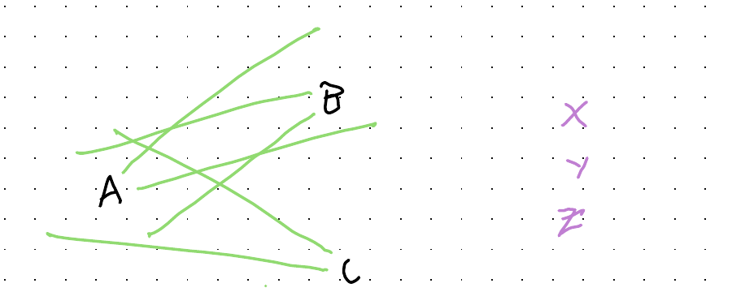

::: {.callout-note}
## About this post: an experiment

This post has been published in two versions at the same time, labelled only **A** and **B**: [Version A](../mmds-a/index.qmd) · [Version B](../mmds-b/index.qmd).

Both versions start from the same handwritten draft by Jon Minton. One is that draft with light proofreading only: typos, grammar slips and hyphenation. The other has been heavily edited by AI. Claude Code (Claude Opus 5.5) acted as the main editor. OpenAI's Codex (gpt-6-astra) then reviewed that edit and suggested rewordings, especially of passages that read as typical of Claude, and Claude Code revised any of those rewordings that read as typical of OpenAI models. Both versions share the same title, figures and section headers. Headers marked † were added by Claude, in both versions.

Which version is which was decided by a coin toss, and the answer is not recorded anywhere in this site's source code. It has been committed in advance as the SHA-256 hash `8fdd2876f883600c12141d05a572ba77e643048c6d1f70f7c8f04738a3cff17c`, so when the answer is revealed, anyone can check that it was not changed after the fact. The hypotheses being tested will be published with the reveal.

Details of how to register which version you prefer will be added here.
:::

In terms of capabilities, the world's never been as unequally distributed as it is right now. The future is here: it's just unequally distributed. And what stops people isn't how well resourced they are. It's mindset and institutional barriers. Within my business I'm hoping to address both. Mindset is the cornerstone issue.

## What gets lost †

Something happened in the last year within software development: people who for years had learned to write code stopped writing code. Or at least stopped writing it directly. They stopped because they realised agentic scaffolds, electronic bodies given to beautiful alien minds to allow them to interact with the electronic world, could translate their intent for a piece of code into the code itself, much faster and more accurately than they could. But they could specify their intent, and they could assess the outputs generated by these models, because they had both the hard-won expertise to know how code works, and what good code looks like; and they had the seniority to switch to the higher-level perspective of purpose, user needs and design.

But this transformation, even within software, has been bittersweet: what happens to future generations of developers when no longer exposed to the rockface of the codebase directly, and when the production of software becomes an act of pedantic conversation? What happens to their ability to discern whether solutions offered by alien minds meet the true intents of human beings? What happens to their ability to confirm both manifest and latent/implicit requirements are being satisfied by these solutions? When does the athlete who becomes a coach cease to be a good coach, because he is no longer an athlete? What about the coach who has never been an athlete, because she has never had the need to develop first-hand experience of building and maintaining and honing a body into a tool of embodied capability and expertise? What is being lost now? What might be lost - in terms of both work-readiness and job purpose and meaning - for future generations?

These are bigger questions than I can cope with. They float around the periphery of my attention constantly. They're unanswerable for now. But given rates of progress in agentic capabilities they're questions whose answers will start to reveal themselves, I fear, faster than we'll be ready for them.

## Harsh but fair †

What I can say, as both an analyst and coder: There is something about the act of writing, running, evaluating, debugging, iterating, restructuring, and refactoring code directly, which as an experience is lost when direct exposure to this type of activity, to the blinking cursor inviting the first symbol to be fed into the empty text file, starts falling away. There is something lost in the act of sending code to be executed, of waiting for a compiler to pronounce its harsh binary judgement on a stream of thousands of hand-chiselled symbols as malformed due to a missing closing parenthesis, an overloaded operator, a one-character typo in a function name instantiation or invocation, and so on. There is something lost in the move to the higher-level abstraction layer of expressing purpose and intent.

Often, in practice, that something lost is frustration, the sense of pushing and prodding at a rockface of literally implemented logical sequences until pieces of it give way to paths taking you inches closer to your intended destination. The sense of rerunning history twenty times, and on all but one occasion finding the rock unyielding, or finding the tunnel you've built collapsing on top of you.

The kind of frustration that comes from hand-coding, however, has an unusual and mixed character. On the one hand it is harsh: one misplaced character can destroy you. On the other hand it is fair: a solution exists, the world is rule-bound and consistent, and though these rules are complex and obscure, they can always be understood with enough effort and knowledge. The rules are the rules, and like the physical constants of the known universe, they care not one jot for organisational structure or social hierarchy.

## A stopgap †

This blog post is for the code chisellers who still want to chisel, but who recognise, either tacitly or explicitly, that the economic niche within which the specific and peculiar predilection towards chiselling they possess has now become undermined. This post is for people who want to be exposed to a stream of experience of failure, but a quality of failure that is harsh but fair. Failure as feedback, as signal offering opportunity for course correction, for always learning, for doing better, inching ever closer towards their destination.

This blog post is for people who recognise their job was a series of games, and that within this series of games the ultimately more satisfying and rewarding games were not those pitting human players against other human players, but one human, or team of humans, against environments of logical symbolism, and within these environments learning how to build structures to satisfy their needs and those of other humans, of building, brick by brick, palaces of the mind.

The solution I offer - half honestly, half satirically - is limited and partial and finite. It's a stopgap. It's arguably even a joke. But it's the solution (or 'solution') I found myself turning to during the first month or so of using agentic AI almost continually during working hours to set up, maintain and develop my business. Within work hours I was indirectly responsible for a lot of working code being written, solving a lot of specific problems relating to both the administration and the broader intentions of the business; for example, on the first day I was able to create a business website, register as a Limited company on Companies House, register with the Information Commissioner's Office, set up company email addresses and phone numbers, and set up an electronic booking system for turning queries into calendar sessions. This would likely have taken weeks otherwise. Since then, co-developing my business with agentic AI has easily taken at least a day a week of administration tasks from my working week, ensured I've never missed an appointment, allowed me to pivot and play with pitches and introductions, let me build around a dozen films, design and redesign the styles and idents for my company, and explore hidden links and patterns between the dozens of conversations and interviews I've had so far. With agentic AI, my company is a team of highly capable intentional beings, even if I am the only one made of flesh and bone.

But having intents whose solutions involved code getting written and executed is not the same as writing code. And so, as someone who has historically liked to code, albeit mainly in the context of data science and statistical analysis, for the first month of my business I found myself drawn to a shadow life, of giving myself something like chiselling code in my downtime, in large part to avoid feeling too much loss in delegating most of my working code to machines.

## Shadow Gambit †

More specifically, for the first month, and during evenings and weekends, I found myself investing a lot of hours in a game called Shadow Gambit, by the now-defunct German indie game developer Mimimi. In Shadow Gambit, you manage a small crew of undead pirates, sent in small teams of usually just three people to infiltrate islands occupied by religious zealots. And by occupied, I mean heavily occupied: in contrast to your infiltration force of three, there are typically over a hundred enemy forces to deal with. Almost always, you start off outnumbered at least twenty to one.

So, is it a power fantasy, you might be wondering? Something like the Doom games, for example, where most enemies put up almost no challenge, are literal cannon fodder, and the flow of violent decimation is, for skilled players, so easy to drift into as to become a form of demonic digital parkour? Not so. In Shadow Gambit, even a single enemy can be a match for each of your characters, and a wrong move can, and almost invariably does, lead to the loss of a mission.

And in Shadow Gambit, single enemies are almost never what you have to be concerned about, because enemies almost never appear in isolation. Instead, enemies appear almost invariably in complex groups of mutually supportive and reinforcing teams: patrol teams of two or three, looked over by sentries with wide visibility, supported by elite troops too powerful for any single character to defeat. Without paying careful attention, trying to attack any one troop within the field will lead to two or three others noticing, who then in turn alert maybe two dozen more. One false move, one mistimed action or step, and this cascade of alarms and attention brings the full weight of a sector's forces to bear on your tiny party. Within seconds, invariably, it's then game over.

## Outnumbered twenty to one †

With these huge asymmetries between forces, how can the player win? This typically involves, loosely, a looped series of steps:

- **Observation and situational awareness**: Look carefully at the arrangement of troops, their colocation, their comparative strengths and limitations, their inherent toughness, their level of embedding within the troops' mutual surveillance and support structure. Consider which troops are covering which other troops. Look for dynamics in these patterns of mutual observation and support over place and time, and whether there are times and periods in patrol sequences where the structure becomes looser and more surgically permeable.
- **Party resources and capabilities**: Not all characters have identical capabilities. Ideally they should have special abilities which complement each other. Some may be less versatile but faster, others may have particular niches opening up infiltration possibilities and strategies not otherwise possible. Regardless, remember that the enemy has a supreme numerical advantage, so any successful approach for neutralising the enemy force depends on breaking the forces to be neutralised down into a manageable sequence of smaller operations.
- **Strategising and sequencing**: With a deep knowledge of the overall challenge to overcome (the enemy forces) and the resources available to address these challenges (your party members), think carefully about how to sequence a series of smaller operations in such a way as to degrade and unravel the Big Problem, in such a way that no single operation, no single step in the sequence, will lead to a catastrophic failure.
- **Implementation and operationalisation**: With a general gameplan ideated, broken down into a proposed sequence of specific operations, the challenge of actually implementing this correctly still remains. The right idea, done wrong, can still be catastrophic, as even mistiming and misplacing an event by a second or a few pixels can still lead to failure. Consider, for each substep in an operation in the sequence, which available party member might be best placed to implement; consider also whether some steps must be executed in parallel rather than in strict series. (Something known in the game as 'Shadow Mode', in which one command leads to two or more party members simultaneously executing a series of pre-defined actions.)

Shadow Gambit is a game where the modal experience of the player tends to be observing and planning, not implementing. As a highly simplified illustration of the importance of observational and situational awareness, consider the following representation of a grouping of troops:

{fig-alt="Hand-drawn sketch: three enemy troops labelled A, B and C, with green lines showing their sightlines to one another, and three party members X, Y and Z off to the right."}

Here A, B and C represent specific enemy forces, X, Y and Z your party, and the green lines emanating from the troops represent the viewcones, indicating which troops are observing which other troops. Here it should be clear the first troop to neutralise should be C, as no troop is guarding them whereas C is guarding A. As a second step both A and B need to be neutralised, but simultaneously, because A guards B and B guards A. In this very simple example your resources X, Y and Z equal those of the enemy, so a simultaneous three-way takedown becomes possible. But then let's turn to a slightly more complicated and realistic example:

{fig-alt="Hand-drawn sketch: four enemy troops A, B, C and D, with green sightlines between them and dashed red circles around each showing hearing range; C and D sit close enough for their hearing circles to overlap. Party members X, Y and Z are off to the right."}

Here not just the viewcones, showing sightlines connecting troops, are shown in green, but there are also dashed red circles indicating what each troop can hear as well. In the game, sound travels less far than sight, but sound awareness is in all directions, rather than more narrowly along the viewcone. Although C and D do not guard each other visually, as do A and B, they do guard each other audially, through their close physical proximity. The types of solution are two-fold: 1) use a special ability possessed by some party members, known as a lure, which will cause C and D to become separated enough to be taken down individually without alerting each other; or 2) attempt a simultaneous take-down of C and D. In either case, the need to sequence the operations becomes clear, simply because there are more enemy forces than party members.

## Save, fail, reload †

As mentioned, even if the right general strategy has been identified, and the party members are well suited to the problems, and the correct sequence of substeps has been determined, failures in execution can still lead, in a few seconds, to game overs. The solution to this, pretty much the only way to play this kind of game, is to save constantly, potentially every few seconds of game time, and then to reload constantly, when - not if - the first five or ten attempts fail either due to poor strategising or implementation. (Most gamers call this pattern save scumming, because saving and loading repeatedly is usually considered a form of cheating, as well as forming a break from the flow of a gaming experience. With Shadow Gambit, no other approach tends to be tenable.)

But what does this type of game, and this approach to completing a game, evoke as a form of experience? I'd suggest it's largely the experience of hand-writing, designing, planning and (especially) debugging code. As with Shadow Gambit, failure with code is sudden, definitive, and frequent. As with Shadow Gambit, the need to keep saving and restoring needs to become an embodied habit. As with Shadow Gambit, failure in making working code can emerge at multiple levels: from having fundamentally the wrong understanding of the situation and means at one's disposal, to having the right idea but applied in the wrong sequence, through to a simple one-letter typo. And as with Shadow Gambit, the modal experience of coding may tend to vacillate between long periods of observing and thinking, and long periods of iterating rapidly through multiple similar attempts at debugging and walking forward one small step at a time.

## A name for the genre †

The formal name for games like Shadow Gambit is unresolved. Mimimi, its creator, preferred the term Stealth Strategy, although other terms, like Real-Time Tactics (RTT), Tactical Stealth, and Commandos-like (after the first game which introduced the core game mechanics), have also been used over time. My preferred term for this subgenre of games is MMDS: **M**editative **M**urder **D**ebugging **S**imulators, hence the acronym in the blog post title.

Regardless, this specific subgenre has always been fairly niche. Over about a quarter century there have perhaps been only two dozen or so games of this type ever made. More sadly still, Shadow Gambit was Mimimi's last ever game, with poor sales leading to the company collapsing. And so far, years after Mimimi's demise, no company appears to have picked up the torch of this highly niche games genre.

But of all types of game, except perhaps those intentionally designed to teach programming (such as Tomorrow Corporation's Human Resource Machine, designed to introduce assembly and machine language thinking; and its sequel 7 Billion Humans, focused more on functional programming paradigms), I've found no type of game that can scratch the itch of hand-chiselling and debugging code as neatly as the MMDS genre can.

Perhaps, I'd suggest, the genre is niche for a reason: that this type of activity is not inherently fun, and that people who have been hand-chiselling code for the last few decades are either drawn from a very unusual neurotype, or have managed to convince themselves that debugging is inherently fun, or some mixture of both.

But if, if hand-chiselling code is something you do find fun, and this is something that, as a result of agentic AI you find yourself doing a lot less in your day job than you used to, then I can recommend MMDS as a way of scratching that particular cognitive itch!
